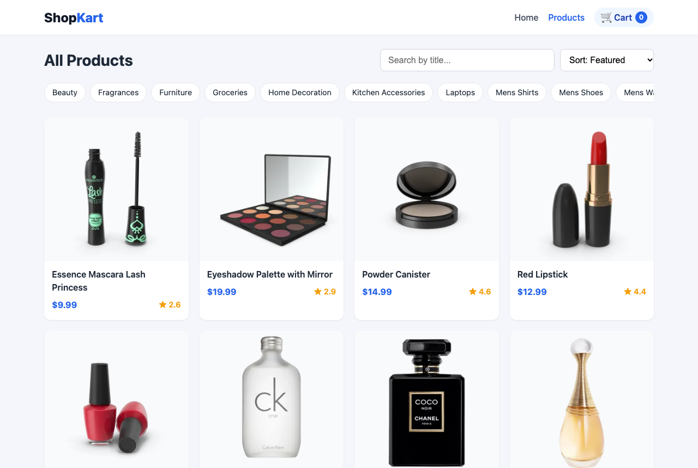
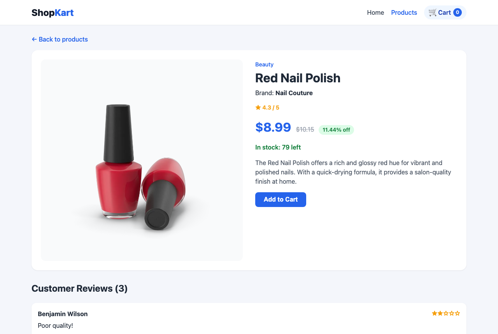
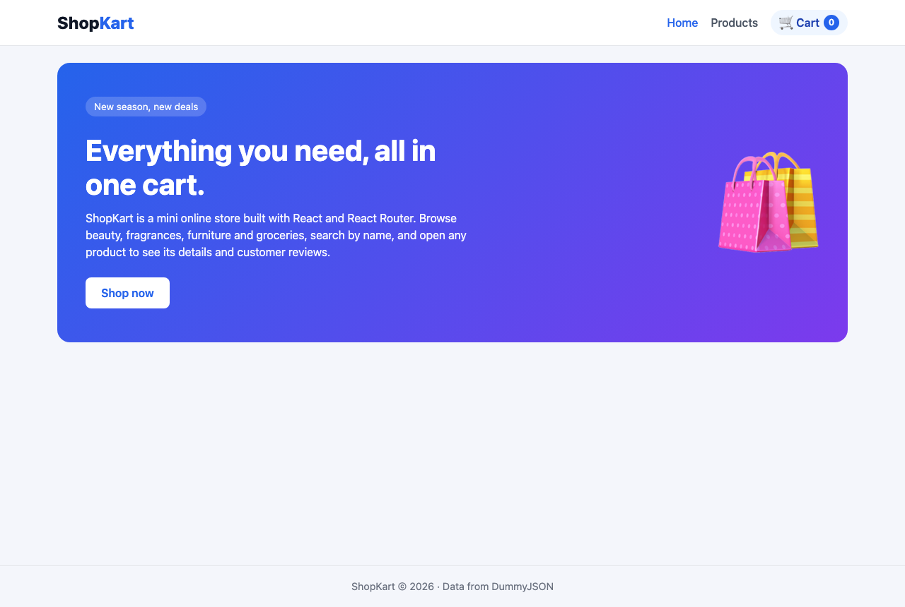

# PS0 – ShopKart: Mini Product Store

A small shopping site built with **React** and **React Router**. It shows a product grid with search, category filtering and price sorting, and a detail page for every product with its images, price, discount, stock and customer reviews.

🔗 **Live link:** https://ps0-shopkart-five.vercel.app

| | |
| --- | --- |
| **PS number** | PS0 |
| **Project name** | ShopKart: mini product store |
| **API used** | [DummyJSON Products API](https://dummyjson.com/docs/products) (free, no API key) |
| **Tech stack** | React 19, React Router 7, Vite, plain CSS |
| **Deployed on** | Vercel |

## Screenshots

### Products page (`/products`)


### Product detail page (`/products/:id`)


### Home page (`/`)


## Routes

| Route | Page shows | API |
| --- | --- | --- |
| `/` | Hero banner, short intro, "Shop now" button to `/products` | none |
| `/products` | Product cards (thumbnail, title, price, rating), search by title, sort by price, category links | `https://dummyjson.com/products?limit=30` |
| `/products/:id` | Big image with gallery, title, brand, description, price, discount %, stock, reviews list, Add to Cart | `https://dummyjson.com/products/:id` |
| `/category/:name` *(bonus)* | Products in one category, sort by price | `https://dummyjson.com/products/category/:name` |
| `*` | "Page not found" + link to Home | none |

## Features

- Product grid with live **search by title**
- **Sort by price** (low → high, high → low) *(bonus)*
- **Category page** for every DummyJSON category *(bonus)*
- **Add to Cart counter** in the Navbar: the state lives in `App` and is passed down as props *(bonus)*
- Product detail page with image gallery, original price, discount %, stock and reviews
- Loading and error states (for example, `/products/9999` shows "Product not found")
- Responsive layout for mobile and desktop
- Direct links such as `/products/5` work on refresh, thanks to `vercel.json`

> **Note:** DummyJSON returns an object, not an array, so the products list is read from `data.products`.

## Project structure

```
src/
├── App.jsx                 # Routes + cart state
├── main.jsx                # BrowserRouter setup
├── index.css               # All styles
├── components/
│   ├── Navbar.jsx          # Logo, links, cart counter
│   ├── ProductCard.jsx     # Card used in the product grids
│   └── SortSelect.jsx      # Price sort dropdown
├── pages/
│   ├── Home.jsx            # /
│   ├── Products.jsx        # /products
│   ├── ProductDetail.jsx   # /products/:id
│   ├── Category.jsx        # /category/:name
│   └── NotFound.jsx        # *
└── utils/
    └── sortProducts.js     # Price sort + category name helpers
```

## Run locally

```bash
git clone https://github.com/shubhamrai9122-creator/ps0-shopkart.git
cd ps0-shopkart
npm install
npm run dev
```

Then open http://localhost:5173.

Other scripts:

- `npm run build`: production build into `dist/`
- `npm run preview`: serve the production build locally
- `npm run lint`: run the linter

## Deployment (Vercel)

The repo is connected to Vercel, so every push to `main` deploys automatically. `vercel.json` sends every path to `index.html`, so React Router can handle routes like `/products/5` without a 404:

```json
{ "rewrites": [{ "source": "/(.*)", "destination": "/" }] }
```
